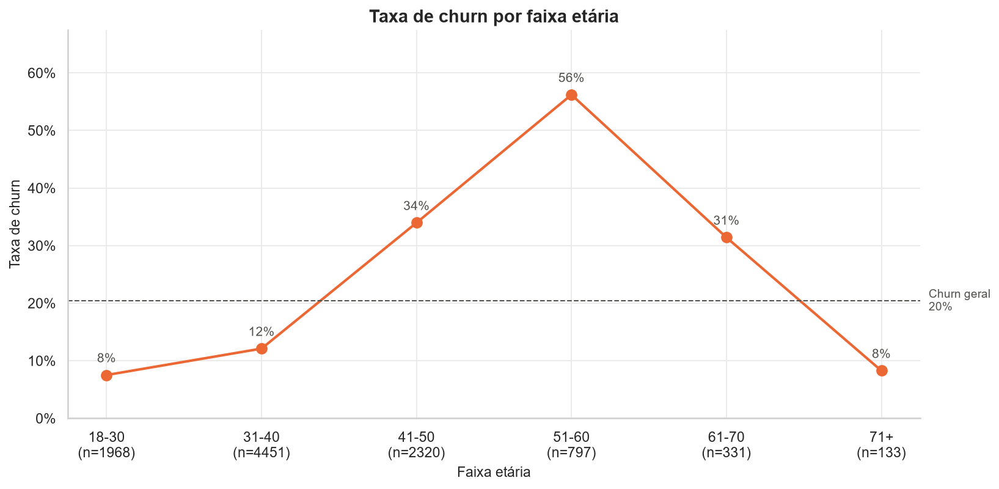
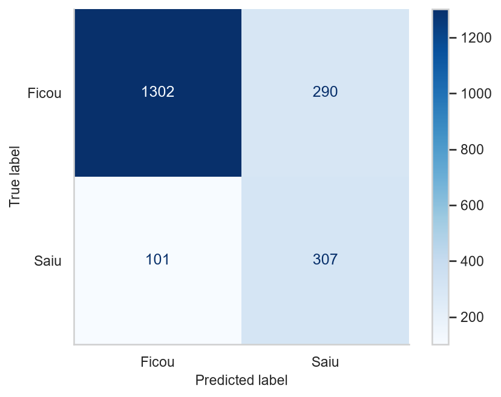

# Bank Customer Churn Prediction

Projeto de Machine Learning para prever a rotatividade de clientes (churn) de um banco. O projeto cobre todo o fluxo de um problema de classificação desbalanceada: análise exploratória, escolha de uma métrica alinhada ao negócio, comparação de 9 combinações de modelos e técnicas de balanceamento com validação cruzada aninhada e avaliação final em um conjunto de teste isolado.

---

## Objetivo

Construir um modelo capaz de identificar, com antecedência, os clientes com maior risco de deixar o banco, permitindo que o time de retenção aja antes da saída.

Reter um cliente costuma ser muito mais barato do que adquirir um novo. Por isso, o foco do modelo é **não deixar clientes em risco passarem despercebidos** (recall alto), sem gerar alarmes falsos em excesso (precisão aceitável).

---

## Dataset

Fonte: [Bank Customer Churn (Kaggle)](https://www.kaggle.com/datasets/radheshyamkollipara/bank-customer-churn).

O arquivo [`Customer-Churn-Records.csv`](data/raw/Customer-Churn-Records.csv) contém **10.000 clientes** e **18 colunas**, sem valores nulos e sem registros duplicados. A variável alvo é desbalanceada: **~20,4% dos clientes deram churn**.

| Coluna | Tipo | Descrição |
|---|---|---|
| `RowNumber` | Numérico | Número do registro (removida) |
| `CustomerId` | Numérico | Identificador único do cliente (removida) |
| `Surname` | Texto | Sobrenome do cliente (removida) |
| `CreditScore` | Numérico | Pontuação de crédito |
| `Geography` | Categórico | País do cliente (`France`, `Spain`, `Germany`) |
| `Gender` | Categórico | Gênero do cliente |
| `Age` | Numérico | Idade |
| `Tenure` | Numérico | Anos de relacionamento com o banco |
| `Balance` | Numérico | Saldo em conta |
| `NumOfProducts` | Numérico | Quantidade de produtos contratados |
| `HasCrCard` | Binário | Possui cartão de crédito |
| `IsActiveMember` | Binário | É membro ativo |
| `EstimatedSalary` | Numérico | Salário estimado |
| `Complain` | Binário | Fez reclamação (removida, ver abaixo) |
| `Satisfaction Score` | Numérico | Satisfação com a resolução da reclamação |
| `Card Type` | Categórico | Tipo de cartão (`SILVER`, `GOLD`, `PLATINUM`, `DIAMOND`) |
| `Point Earned` | Numérico | Pontos acumulados com o cartão de crédito |
| `Exited` | Binário | **Variável alvo**: 1 se o cliente saiu do banco, 0 caso contrário |

### Data Leakage: a variável `Complain`

O heatmap de correlação mostrou que `Complain` tem correlação praticamente perfeita (0,996) com `Exited`: dos 2.044 clientes que reclamaram, 2.034 saíram do banco. Na prática, a reclamação formal acontece junto com o processo de saída ou como consequência dele, então não é uma informação disponível *antes* do churn. Mantê-la não faria o modelo aprender a prever quem está prestes a sair do banco, mas sim olhar somente para a variável `Complain` na hora de classificar. Por isso, a coluna foi removida.

---

## Metodologia

### 1. Análise exploratória (EDA)

Notebook: [`01_eda.ipynb`](notebooks/01_eda.ipynb).

- **Univariada:** `Age` é assimétrica à direita (outliers acima de 62 anos), `CreditScore` tem um pico no teto da escala (850) e **36% dos clientes têm saldo zero**. `EstimatedSalary` e `Point Earned` são praticamente uniformes, um sinal de dados sintéticos.
- **Bivariada (contra `Exited`):**
  - `NumOfProducts`: a variável mais determinante. Clientes com 2 produtos churnam 7,6%, quase 4x menos que os com 1 produto (27,7%). Com 3 e 4 produtos o churn passa de 80%, mas esses grupos são só 3,3% da base.
  - `Age`: a relação não é linear. O churn sobe de 8% (18-30 anos) até **56% (51-60 anos)** e volta a cair para 8% acima dos 70.
  - `Geography`: a Alemanha tem o dobro da taxa de churn dos outros países (32%).
  - `IsActiveMember` e `Gender`: inativos churnam quase o dobro dos ativos (26,9% x 14,3%), e mulheres mais que homens (25,1% x 16,5%).
  - `Balance`: clientes com saldo zero churnam menos (13,8% x 24,1%), mas isso vem da composição do grupo: **nenhum cliente da Alemanha tem saldo zero**, e 72% deles têm 2 produtos. Comparando dentro de cada país, a diferença diminui.
- **Correlação perto de zero não quer dizer irrelevância:** `NumOfProducts` tem correlação linear de apenas -0,05 com o churn, porque a relação é não linear.



### 2. Preparação dos dados

Notebook: [`02_modelagem.ipynb`](notebooks/02_modelagem.ipynb).

- Split estratificado **80% treino / 20% teste** (`random_state=42`). O conjunto de teste só é usado na avaliação final.
- Pré-processamento com `ColumnTransformer`:
  - `OneHotEncoder` para `Geography`, `Gender` e `Card Type`;
  - `StandardScaler` para as variáveis numéricas.
- Todo o pré-processamento fica **dentro de uma `Pipeline`**, sendo reajustado a cada dobra da validação cruzada, o que evita vazamento de dados entre treino e validação.

### 3. Métrica de otimização: F2-score

Recall puro pode ser "trapaceado": um modelo que classifica todo mundo como churn tem recall de 100%. A métrica escolhida foi o **F2-score**, média harmônica entre precisão e recall com peso maior no recall:

$$F_\beta = (1 + \beta^2) \cdot \frac{precisão \cdot recall}{\beta^2 \cdot precisão + recall}, \quad \beta = 2$$

Ela traduz a regra de negócio: *perder um cliente custa mais caro do que oferecer um desconto desnecessário, mas não infinitamente mais caro.*

### 4. Baselines

Antes de otimizar, três referências foram avaliadas com `StratifiedKFold` (5 dobras):

| Modelo | F2 | Recall | Precisão |
|---|---|---|---|
| `DummyClassifier` (classe majoritária) | 0,000 | 0,000 | 0,000 |
| `LogisticRegression` | 0,238 | 0,207 | 0,598 |
| `DecisionTreeClassifier` (`max_depth=10`) | 0,494 | 0,471 | 0,616 |

O `DummyClassifier` acerta ~80% dos casos sem prever nenhum churn, o que mostra por que **acurácia não serve** como métrica prioritária aqui.

### 5. Modelagem com validação cruzada aninhada

Foram testados **3 algoritmos × 3 estratégias de balanceamento = 9 combinações**:

- Algoritmos: `DecisionTreeClassifier`, `RandomForestClassifier` e `LogisticRegression`;
- Balanceamento: `class_weight='balanced'` (como hiperparâmetro), oversampling com `SMOTE` e undersampling com `NearMiss` (versões 1, 2 e 3). As técnicas de amostragem rodam dentro de uma `imblearn.pipeline.Pipeline`, sendo aplicadas somente nos dados de treino de cada dobra.

Cada combinação foi otimizada com `RandomizedSearchCV` (refit por F2) em uma **validação cruzada aninhada**, implementada uma única vez na função `avaliar_busca_aninhada` ([`src/modelagem.py`](src/modelagem.py)):

- **Loop interno** (`StratifiedKFold`, 3 dobras): busca de hiperparâmetros;
- **Loop externo** (`StratifiedKFold`, 5 dobras): estimativa honesta do desempenho do processo de busca.

### 6. Ranking (validação cruzada aninhada, conjunto de treino)

| Modelo | F2 | Desvio | Recall | Precisão | F1 |
|---|---|---|---|---|---|
| **Random Forest** | **0,683** | 0,011 | 0,743 | 0,517 | 0,610 |
| Random Forest + NearMiss | 0,651 | 0,011 | 0,707 | 0,494 | 0,582 |
| Random Forest + SMOTE | 0,639 | 0,020 | 0,651 | 0,594 | 0,621 |
| Decision Tree + NearMiss | 0,633 | 0,013 | 0,848 | 0,315 | 0,459 |
| Decision Tree | 0,630 | 0,014 | 0,712 | 0,433 | 0,537 |
| Decision Tree + SMOTE | 0,617 | 0,017 | 0,660 | 0,503 | 0,567 |
| Logistic Regression | 0,602 | 0,019 | 0,707 | 0,378 | 0,493 |
| Logistic Regression + SMOTE | 0,584 | 0,016 | 0,700 | 0,355 | 0,469 |
| Logistic Regression + NearMiss | 0,574 | 0,010 | 0,755 | 0,293 | 0,422 |

O **Random Forest com `class_weight='balanced'`** venceu com o maior F2 e um dos menores desvios entre dobras. Técnicas de amostragem não superaram o balanceamento por peso de classe. O `NearMiss` com Decision Tree, por exemplo, atinge recall de 0,848, mas derruba a precisão para 0,315.

Hiperparâmetros do modelo vencedor:

```
max_depth        = 8
min_samples_leaf = 20
max_features     = 0.5
class_weight     = balanced
```

---

## Métricas finais (conjunto de teste)

Avaliação do modelo vencedor nos **2.000 clientes** do conjunto de teste, nunca vistos durante o treino e a otimização:

| Métrica (classe churn) | Valor |
|---|---|
| **F2-score** (métrica-alvo) | **0,689** |
| Recall | 0,752 |
| Precisão | 0,514 |
| F1-score | 0,611 |
| Acurácia | 0,804 |



### Leitura de negócio

Dos 2.000 clientes de teste, 408 realmente saíram do banco:

- **307 clientes em risco foram identificados** (75,2% dos que sairiam), e o time de retenção teria a chance de agir.
- **101 clientes saíram sem nenhum alerta**. É o erro mais caro.
- **290 clientes receberiam contato desnecessário**. É o erro barato: custa a ação de retenção, não o cliente.

**Limitação:** com precisão de 51,4%, cerca de metade dos alertas é falso positivo. Aumentar a precisão exigiria aceitar um recall menor. Qual erro priorizar é uma decisão de negócio e depende da relação entre o custo de uma campanha de retenção e o valor de um cliente perdido.

---

## Estrutura do projeto

```
bank-customer-churn-prediction/
├── data/
│   ├── raw/                  # dataset original do Kaggle
│   └── processed/            # dataset tratado, gerado pelo notebook 01_eda
├── notebooks/
│   ├── 01_eda.ipynb          # análise exploratória
│   └── 02_modelagem.ipynb    # modelos, validação cruzada aninhada e avaliação final
├── src/
│   ├── config.py             # semente e caminhos do projeto
│   ├── visualizacao.py       # padrão visual e funções de gráfico
│   └── modelagem.py          # busca de hiperparâmetros com validação cruzada aninhada
├── models/
│   └── modelo_churn.pkl      # pipeline final treinada, gerada pelo notebook 02_modelagem
├── reports/figures/          # figuras usadas neste README
├── requirements.txt
└── LICENSE
```

---

## Como rodar

```bash
git clone https://github.com/ghfreiree/bank-customer-churn-prediction.git
cd bank-customer-churn-prediction

python -m venv .venv
source .venv/bin/activate        # Windows: .venv\Scripts\activate

pip install -r requirements.txt
```

Depois, abra os notebooks da pasta `notebooks/` no VS Code (ou no Jupyter, depois de `pip install notebook`) e execute **na ordem**: o `01_eda` gera o dataset tratado que o `02_modelagem` usa. Os caminhos ficam centralizados em [`src/config.py`](src/config.py), então os notebooks funcionam sem alterações.

> A validação cruzada aninhada treina centenas de modelos. A execução completa do `02_modelagem` pode levar alguns minutos.

### Usando o modelo salvo

O arquivo `models/modelo_churn.pkl` contém a pipeline completa (pré-processamento + Random Forest). Ela recebe os dados no mesmo formato do CSV tratado, sem a coluna `Exited`:

```python
import pickle
import pandas as pd

with open('models/modelo_churn.pkl', 'rb') as arquivo:
    modelo = pickle.load(arquivo)

clientes = pd.read_csv('data/processed/Customer-Churn-Tratado.csv').drop(columns='Exited')
probabilidade_churn = modelo.predict_proba(clientes)[:, 1]
```

> O `pickle` só deve ser usado com arquivos de origem confiável, porque carregar um `.pkl` pode executar código. O modelo também depende das versões do `requirements.txt` (principalmente do scikit-learn).

---

## Tecnologias utilizadas

- **Linguagem:** Python 3.13
- **Bibliotecas:** pandas, NumPy, scikit-learn, imbalanced-learn, Matplotlib, Seaborn
- **Ambiente:** Jupyter Notebook (VS Code)
